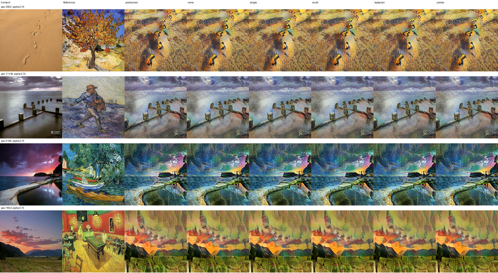

# Structure-preserving style transfer: does it actually help?

This repo looks at how much an explicit structure loss helps reference-based style transfer, and whether the answer changes depending on how you measure it. The main claims were fixed in a protocol file before I ran the held-out test set, and the test was run once.



Test set, the first four test content images (not hand-picked), style strength alpha = 0.75. Columns are the content image, the reference painting, and then one column per training condition.

## Motivation

Style transfer models tend to wash out the structure of the content image (edges, object outlines, layout) as the style gets stronger. A common fix is to add a structure term to the loss. The problem is how these fixes usually get evaluated:

- Models are compared at the same style-strength setting, but a model that simply stylizes less will look better on structure at any fixed setting.
- Results are often reported on the same structure metric the model was trained to minimize.

I wanted to know how much a structure loss helps once both of these are controlled for, and how different kinds of structure loss compare.

## What I did

- Backbone: a pretrained AdaIN model (Huang & Belongie, 2017), using the [pytorch-AdaIN](https://github.com/naoto0804/pytorch-AdaIN) port. The VGG encoder stays frozen and only the decoder is fine-tuned.
- Strength control: I interpolate in feature space before decoding, f = (1 - alpha) * f_content + alpha * AdaIN(f_content, f_style), instead of blending pixels.
- My structure loss: signed Sobel gradients of the luminance, normalized by their magnitude and compared on a 3-level Gaussian pyramid, with more weight on edges. Scale weights are 0.2, 0.3 and 0.5 from fine to coarse.
- Training: loss = content + 10 x style + structure, 500 Adam steps at lr 1e-5. Every condition gets exactly the same budget, starts from the same weights, and sees the same training pairs.

The six conditions:

| Condition | Structure term |
|---|---|
| pretrained | none, the original decoder |
| none | fine-tuned with no structure term |
| single | Sobel loss at full resolution only |
| multi | Sobel loss on the 3-level pyramid |
| laplacian | Laplacian loss on 4x4 and 16x16 pooled images (Li et al., 2017), weight set so its size matches multi |
| combo | half multi, half laplacian, fixed in advance and not tuned |

## How I evaluated it

- Matched style strength. For every content/reference pair, I interpolate each model's metric curve at the style error that the "none" model reaches at alpha = 0.25, 0.5 and 0.75. That way every model is compared at the same amount of stylization. Points are only kept where all curves overlap, and nothing is extrapolated.
- Metrics that were not used in training, all computed against the content image: SSIM on luminance, Canny edge F1 with 2 px tolerance, and LPIPS (AlexNet).
- Statistics. Many pairs share the same content image or the same reference painting, so they are not independent samples. I use a crossed bootstrap that resamples content images and references separately (10,000 draws), and sign tests at the content-image level.
- Three training runs (seeds 17, 43, 101), all starting from the same pretrained weights.
- Sanity checks. The evaluation code reproduces all 3,840 per-pair numbers from the original experiment exactly, and the training loop for the new baselines reproduces the saved training losses to within 4e-4.
- Held-out test. 32 content images x 8 reference paintings (256 pairs) from a split never used for any decision. The selection rule, the hashes of all 16 models and the analysis plan were written to [PROTOCOL.json](evaluation/results/test/PROTOCOL.json) before the run.

## Results

Test set, compared at matched style error, averaged over 3 seeds (2,292 of 2,304 points kept). Lower is better for structure error and LPIPS, higher is better for SSIM and edge F1.

| Condition | Structure error | SSIM | Edge F1 | LPIPS |
|---|---:|---:|---:|---:|
| pretrained | 0.4404 | 0.3386 | 0.6286 | 0.4104 |
| none | 0.4360 | 0.3367 | 0.6303 | 0.4054 |
| single | 0.4323 | 0.3386 | 0.6309 | 0.4053 |
| multi | 0.4202 | 0.3410 | 0.6330 | 0.4042 |
| laplacian | 0.4233 | 0.3396 | 0.6337 | 0.4030 |
| combo | 0.4216 | 0.3405 | 0.6336 | 0.4035 |

Change compared with "none" on the three held-out metrics. All of these have 95% bootstrap intervals that exclude zero, except the one marked n.s.

| Condition | SSIM | Edge F1 | LPIPS |
|---|---:|---:|---:|
| single | +0.58% | +0.08% | -0.03% (n.s.) |
| multi | +1.28% | +0.43% | -0.30% |
| laplacian | +0.87% | +0.53% | -0.60% |
| combo | +1.13% | +0.51% | -0.47% |

The validation set (16 x 4 pairs) gives the same ranking and almost the same effect sizes. For example, multi vs. none there is +1.29% SSIM, +0.32% edge F1 and -0.27% LPIPS. Full tables are in `evaluation/results/step2_summary.txt` (validation) and `evaluation/results/test/test_summary.txt` (test).

### What I take from this

1. The structure loss does help, and not only on the metric it was trained on. At matched style strength, multi improves SSIM, edge F1 and LPIPS, and the direction holds for all 8 held-out reference paintings.
2. No single structure loss wins everywhere. My gradient-pyramid loss is best on SSIM, the Laplacian loss is best on LPIPS, and the 50/50 combination lands in between. The ranking is the same on validation and test.
3. The gain comes from the structure term, not from extra fine-tuning. Fine-tuning without any structure term does not improve SSIM over the pretrained decoder on the test set.
4. Measuring on the training metric overstates the effect. Multi lowers its own structure error by 3.6%, but improves the independent metrics by only 0.3% to 1.3%.

## Running it

```bash
pip install -r requirements.txt

# data: vangogh2photo from the CycleGAN repo (https://github.com/junyanz/pytorch-CycleGAN-and-pix2pix),
# unpacked so that <DATA>/trainA, trainB, testA, testB exist.
# The split and duplicate review I used are in configs/vangogh_split_v1.json.
export STYLIZATION_DATA_ROOT=/path/to/vangogh2photo

# download the upstream AdaIN code and weights and check their hashes
python scripts/qualify_adain.py --data-root $STYLIZATION_DATA_ROOT

# original three-seed experiment (pretrained / none / single / multi)
python scripts/run_adain_confirmation.py --data-root $STYLIZATION_DATA_ROOT --output outputs/my_run

# held-out metrics, extra baselines, and the one-time test
python evaluation/step1_independent_eval.py
python evaluation/step3_laplacian.py                 # laplacian baseline
python evaluation/step3_laplacian.py --mode combo    # combo
python evaluation/step2_analyze.py                   # validation analysis
python evaluation/step4_test_eval.py                 # held-out test, runs once
```

The evaluation scripts read the original experiment from `outputs/adain_confirmation_v1/`. The per-pair metrics, training logs and plans from that run are included, so `step2_analyze.py` can be re-run without a GPU.

## Layout

```
scripts/                       training, original analysis, inference, demo
  adain_structure_research.py  single- and multiscale structure losses
  run_adain_confirm_worker.py  per-seed training and validation evaluation
src/stylization/               data loading
configs/                       data split, release config
outputs/adain_confirmation_v1/ original experiment: plans, logs, per-pair metrics
evaluation/                    held-out metrics, baselines, test evaluation
  results/                     summaries, per-pair CSVs, test protocol
```

## Limitations

- Small study: 3 training runs, one art style (Van Gogh), 256 x 256 images.
- The effects are small (0.3% to 1.3% on the held-out metrics). They are consistent, but I did not run a human preference study.
- SSIM and edge F1 were not used in training, but they measure something close to what the structure loss targets. LPIPS is the most independent of the three, and there the Laplacian loss is best.
- The Laplacian weight was matched in size to my loss rather than tuned, so a tuned Laplacian baseline might do better.
- I don't know how much the AdaIN pretraining data overlaps with this dataset.

## References

- Huang and Belongie, Arbitrary Style Transfer in Real-time with Adaptive Instance Normalization, ICCV 2017.
- Li, Xu, Nie and Chua, Laplacian-Steered Neural Style Transfer, ACM Multimedia 2017.
- Zhu, Park, Isola and Efros, Unpaired Image-to-Image Translation using Cycle-Consistent Adversarial Networks, ICCV 2017 (vangogh2photo dataset).
- Inoue, pytorch-AdaIN, https://github.com/naoto0804/pytorch-AdaIN

## License

My code is MIT licensed (see LICENSE). The AdaIN port, its weights and the dataset images have their own terms, see THIRD_PARTY_NOTICES.md.

## Note

I wrote the code with help from an AI coding assistant. I ran all the experiments on my own machine and I'm responsible for the results and how they're interpreted.
